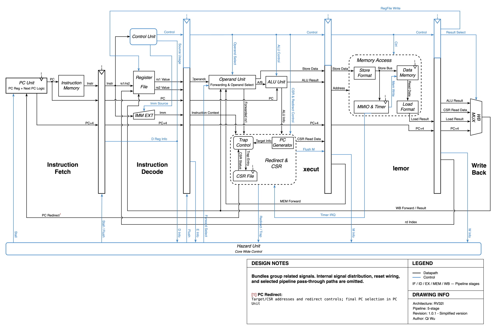

# Hazel

Hazel is a 32-bit RISC-V processor that I'm building in SystemVerilog to teach
myself CPU design. I learned the theory from *Digital Design and Computer
Architecture: RISC-V Edition* by Harris and Harris, and this is where I build a
core on my own. I want to be able to explain every module and every control
decision in it, so I keep the design plain.

So far it is a five-stage, in-order RV32I pipeline with a small machine-mode
trap path and a one-shot timer interrupt. I run it in Verilator against my own
directed tests and 19 upstream `rv32ui` tests. Next I'm putting it into a small
SoC and onto a NEXYS Artix-7 board. I named it after the hazel tree, which
starts as a tiny seed and gradually becomes a full-grown tree. I'm growing the
core the same way, one phase at a time.

[](docs/Datapath_Simplified_v1.0.1.svg)

I keep two versions of the datapath diagram. This simplified one shows the main
blocks of each stage and groups related signals into bundles. Black lines carry
data and blue lines carry control. The [complete version](docs/Datapath_v1.5.1.svg)
has every signal, and the
[architecture notes](docs/core-architecture.md#datapath-overview) walk through
it stage by stage.

## What Works

- Five stages (IF, ID, EX, MEM, WB), with a `valid` bit in every pipeline register
- Register and immediate ALU instructions, all six branches, `jal`, `jalr`, `lui` and `auipc`
- Byte, halfword and word loads and stores to an internal data RAM
- Forwarding from MEM and WB into EX, and a one-cycle load-use stall
- Eight machine-mode CSRs, all six Zicsr instructions, `ecall`, `ebreak` and `mret`
- Precise exceptions for illegal instructions and misaligned branch or jump targets, loads and stores
- A one-shot machine-timer interrupt, set through memory-mapped `mtimecmp`

## How I Built It

I worked in phases, each with a plan and exit criteria in
[docs/plans](docs/plans/README.md). Before writing any RTL, I wrote down what
the first version would and wouldn't do. Then came the pipeline, the hazard
unit, the test setup and the trap path.

I kept the core in order, with branches resolved in EX, because that keeps the
control simple and easy to test. The price is two lost cycles on every taken
branch or jump and one on a load-use stall. I want to measure that on real
software before I optimize it.

For traps I split four jobs across modules: finding the fault, picking which
trap wins, updating the CSRs and redirecting the PC. That keeps `csr_file.sv`
from turning into a second control unit. If an instruction faults in the same
cycle that the timer interrupt arrives, the fault wins. It belongs to that
instruction, and the timer request simply stays pending. The
[trap notes](docs/csr-trap-design.md) have the details.

The bug I learned the most from showed up in May 2026, in my hazard smoke test.
`x3` should have been 23 and came out as 7. Forwarding covers a reader one or
two instructions behind the writer. At three apart, the writer is in WB while
the reader is in ID, and my register file still gave ID the old value. The
write only lands at the next clock edge. With stale reads at that distance,
the program ends with exactly 7.

The book handles this case by writing the register file on the falling edge.
Mine writes on the rising edge like everything else, so I added a bypass on
the read ports. When WB writes the register that ID is reading, ID gets the WB
value directly. A module test would not have caught this. The register file
did exactly what I had specified, and the specification was the problem.
`reg_file_tb` now checks the bypass directly.

## Running the Tests

`sim/run_regression.sh` runs seven module tests, twelve smoke programs and a
[Cocotb test for the register file](docs/verification.md#cocotb-regfile-checks)
that I wrote to learn Cocotb. Module tests drive one block at a time, so a
failure points at one signal. Smoke programs run through the whole pipeline
and catch problems between instructions, like the bypass bug.

`sim/run_isa_lite.sh` runs 19 of the upstream `rv32ui` tests. Their official
environment needs more privileged support than my core has, so I replaced it
with a small one that reports pass or fail in `x31`.

You need Verilator, a C++ compiler and a RISC-V GNU toolchain with
`riscv64-elf-*` commands. The Cocotb test also needs
[Cocotb 2.x in an active Python environment](sim/README.md#cocotb-regfile), and
ISA-lite needs a [riscv-tests checkout](tools/README.md#riscv-tests).

```bash
bash sim/run_regression.sh          # module, smoke and Cocotb tests
bash sim/run_isa_lite.sh            # the selected rv32ui tests
bash sim/run_isa_lite.sh ori        # one rv32ui test
TRACE=1 bash sim/run_data_mem.sh    # one module test, with a VCD for GTKWave
```

The [simulation guide](sim/README.md) has every runner and output path, and
[verification](docs/verification.md) says what each test covers and what it
doesn't.

## FPGA Results So Far

I've only taken the core through Vivado 2026.1 synthesis and implementation,
for an Artix-7 `xc7a100tcsg324-1` at 50 MHz. It hasn't run on the board yet.
Two runs with different programs in the instruction ROM both meet timing:

| | `smoke_alu` (2026-11-01) | `smoke_csr_trap` (2026-11-02) |
| --- | ---: | ---: |
| LUTs after synthesis, including LUTRAM | 1344 | 2298 |
| LUTRAM | 0 | 128 |
| Flip-flops after synthesis | 1451 | 1916 |
| BRAM tiles after synthesis | 0 | 0 |
| Worst setup slack after routing | +2.357 ns | +1.406 ns |
| Worst hold slack after routing | +0.130 ns | +0.114 ns |

The numbers differ because of the program, not the RTL. `smoke_alu` never
touches the data RAM, CSRs or timer, so Vivado removed them. `smoke_csr_trap`
keeps them and is closer to the full core. Its data RAM went into LUTRAM
instead of block RAM, because my data memory reads combinationally and block
RAM needs a registered read.

In that run the worst setup path ends at the synchronous clear of the ID/EX
register, with 17.8 ns of delay, about three quarters of it routing. I think it
goes through forwarding, the branch compare and the flush, but I haven't
confirmed that in the timing report yet.

## What's Missing and What's Next

- Not all of RV32I (no `fence` yet) and not the privileged spec. My tests don't
  prove compliance.
- Instruction and data memory are arrays inside the core, with no memory
  interface yet.
- Instruction memory holds 256 words, and ISA-lite only loads instructions, so
  the upstream load/store tests don't run yet.
- The timer interrupt is one-shot. There are no software or external
  interrupts and no nested traps.

Phase 5 is next. I'll define a request/response interface between the CPU and
the rest of the system, build a small SoC with ROM, RAM, UART and the timer,
and bring it up on the board. After that come system-level tests, then Cache,
FPU and a small RTOS. The [phase list](docs/plans/README.md#phase-list) has the
plan for each step, and ideas I'm not working on yet go in the
[backlog](docs/backlog.md).

## Where Things Are

| Path | What's there |
| --- | --- |
| `rtl/core/` | Stages, pipeline registers, datapath, control, CSRs and traps |
| `rtl/memory/`, `rtl/peripherals/`, `rtl/soc/` | Memories, machine timer, top-level wrapper and MMIO decoder |
| `tb/` | SystemVerilog testbenches and the Cocotb test in `tb/cocotb/reg_file/` |
| `programs/` | My assembly test programs (`asm/`) and their images (`hex/`) |
| `sim/` | Build and test scripts |
| `software/` | Linker script, a minimal trap runtime, the ISA-lite environment and build scripts |
| `docs/` | Diagrams, design notes, verification, plans, backlog and tool notes |
| `tools/` | Upstream checkouts such as riscv-tests, not part of this repository |

My design notes are on the [core architecture](docs/core-architecture.md),
[CSRs, traps and the timer](docs/csr-trap-design.md),
[verification](docs/verification.md) and the
[phase plans](docs/plans/README.md). I also keep learning notes on
[data-memory addressing](docs/data-memory-addressing.md) and the
[tool chain](docs/tool-chain-notes/).

I use AI as a tutor and reviewer here. I lead the design, implementation and
testing, and AI explains, discusses designs with me and reviews my work. The
rules are in [AGENTS.md](AGENTS.md).
