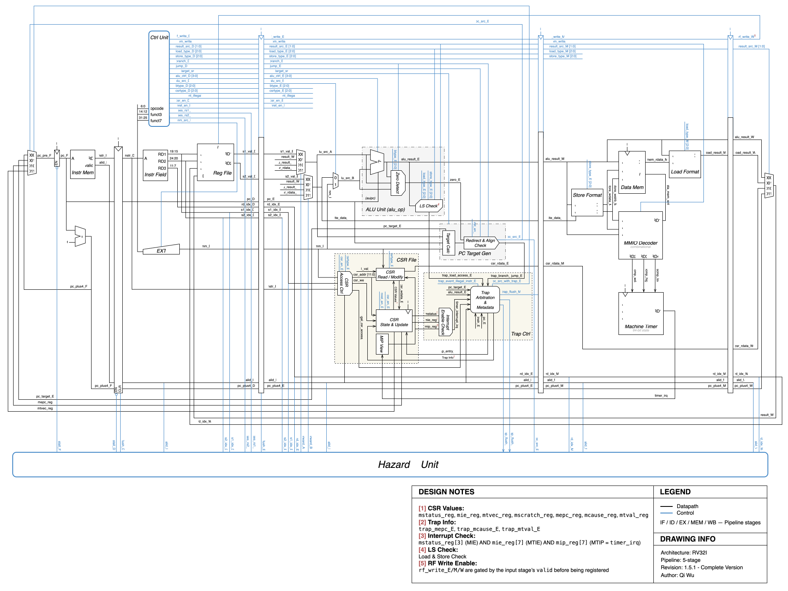

# Core Architecture

Hazel's core is a 32-bit, in-order, single-issue pipeline with the usual five
stages (IF, ID, EX, MEM and WB). It decodes all of RV32I except `fence`,
which traps as an illegal instruction for now. It also has a small
machine-mode trap path with a one-shot timer interrupt. The trap side has its
own notes in [CSRs, traps and the timer](csr-trap-design.md).

I split the core into many small modules with explicit ports. `core.sv` needs
more wiring that way, but every control signal stays visible, which makes the
pipeline easier for me to check and explain.

## Datapath Overview

I keep the datapath in two versions. The
[simplified diagram](Datapath_Simplified_v1.0.1.svg) shows the main blocks of
each stage with related signals grouped into bundles, so it's the better first
read. The complete diagram below has every signal, and the rest of this
section follows it.

[](Datapath_v1.5.1.svg)

The [full-size diagram](Datapath_v1.5.1.svg) shows every signal label and the
notes I put on it. Black lines carry data and blue lines carry control. The
suffixes `F`, `D`, `E`, `M` and `W` say which stage a signal belongs to.

It's easiest to read in three passes.

1. Follow one instruction from the PC and instruction memory through Decode,
   Execute, Memory and Writeback. The four vertical pipeline registers carry
   its data, control and `valid` bit between stages.
2. Trace the MEM and WB feedback paths into the EX operand muxes. The hazard
   unit at the bottom picks the forwarding sources and drives stalls and
   flushes.
3. Follow the redirect paths back to the PC mux. `pc_target_gen.sv` forms
   branch and jump targets, `trap_ctrl.sv` picks the trap, and `csr_file.sv`
   holds the state that trap entry and `mret` use.

The CSR Access Ctrl, CSR Read/Modify, CSR State & Update and MIP View boxes
show the separate jobs inside `csr_file.sv`. In the RTL they are one module.
The interrupt-enable check and trap priority live in `trap_ctrl.sv`.

## Where the RTL Lives

| Path under `rtl/` | What's there |
| --- | --- |
| `core/` | `core.sv`, which connects the stages and the hazard unit, and the shared types in `core_types_pkg.sv` |
| `core/stages/` | `if_stage`, `id_stage`, `ex_stage`, `mem_stage` and `wb_stage` |
| `core/pipeline/` | The four pipeline registers `IF_ID`, `ID_EX`, `EX_MEM` and `MEM_WB` |
| `core/datapath/` | ALU, register file, immediate and field extraction, PC logic, operand and writeback muxes, load/store formatting |
| `core/control/` | Instruction decode and the hazard unit |
| `core/csr/` | CSR state and trap priority, as two separate modules |
| `memory/` | Instruction and data memory arrays |
| `peripherals/` | Machine timer |
| `soc/` | Top-level wrapper, MMIO decoder and address map |

Integrated simulations and editor lint use [rtl/filelist.f](../rtl/filelist.f).
Its paths start at the repository root, with packages first.

The folders group files by job. The instance tree is different. Instruction
memory still sits inside `if_stage`, and data memory, the MMIO decoder and the
timer sit inside `mem_stage`, all below `core`. `soc/top.sv` only wraps the
core so far. I'll move those blocks up to the SoC level in Phase 5, once the
CPU has a request/response memory interface.

## Pipeline Stages

| Stage | What it does | What it passes on |
| --- | --- | --- |
| IF | Holds the PC, fetches one instruction and computes `PC + 4` | PC, instruction, `PC + 4` |
| ID | Decodes control, reads the register file, extracts register fields and builds the immediate | Source values and indexes, destination index, immediate, instruction, control |
| EX | Forwards operands, runs the ALU, forms data addresses and branch/jump targets, runs CSR instructions and decides traps | ALU result, store data, destination index, `PC + 4`, CSR read data, reduced control |
| MEM | Formats stores, decodes timer MMIO, accesses data memory, extracts and extends load data | ALU result, load result, destination index, `PC + 4`, CSR read data, writeback control |
| WB | Selects the final result and writes the register file | Register file update |

Every pipeline register carries a `valid` bit. A flush clears it and loads NOP
control. On a normal clock edge, each register also ANDs the side-effect
controls it carries (register write, memory write, jump, branch, `mret`) with
`valid`. A flushed instruction therefore becomes a bubble that can't write
anything or move the PC. The trap event is gated the same way. A bubble's
instruction bits are all zero, which would otherwise decode as an illegal
instruction.

### Stage Modules

Until October 2026 all the stage wiring lived in `core.sv`. Then I split it
into five plain `.sv` modules with explicit ports and no `.svh` includes.
[core.sv](../rtl/core/core.sv) now instantiates them and the hazard unit and
wires them together with the bundles from
[core_types_pkg.sv](../rtl/core/core_types_pkg.sv).

| Source | Instance | What's inside |
| --- | --- | --- |
| [if_stage.sv](../rtl/core/stages/if_stage.sv) | `if_stage1` | PC mux and register, `PC + 4`, instruction memory, `IF_ID` |
| [id_stage.sv](../rtl/core/stages/id_stage.sv) | `id_stage1` | Control decode, register file, instruction fields, immediate, `ID_EX` |
| [ex_stage.sv](../rtl/core/stages/ex_stage.sv) | `ex_stage1` | Forwarding muxes, ALU, target generation, `trap_ctrl`, `csr_file`, `EX_MEM` |
| [mem_stage.sv](../rtl/core/stages/mem_stage.sv) | `mem_stage1` | Load/store formatting, data memory, MMIO decoder, timer, `MEM_WB` |
| [wb_stage.sv](../rtl/core/stages/wb_stage.sv) | `wb_stage1` | Final result mux, no pipeline register |

Each stage owns the pipeline register on its output, so `EX_MEM` sits inside
`ex_stage1`. Its outputs (the ALU and CSR results now in MEM) also feed back
into the EX forwarding muxes. `wb_stage1` sends the selected result to EX and
to the register file write port in `id_stage1`. The register file sits in the
ID module, but its write enable and destination index come from WB, so the
write itself still happens in WB.

The stage modules add hierarchy, not cycles. There are still five stages and
four pipeline registers. Signals that the testbenches and Vivado observe now
go through the stage instances, as described in
[verification](verification.md#stage-hierarchy-and-observation-paths).

## Who Decides What

I split control so that each block has one job. A block that detects an event
reports it. It doesn't also decide priority or change architectural state.

| Block | Its job |
| --- | --- |
| `control_unit.sv` | Decodes the instruction into the ID control bundle |
| `hazard_unit.sv` | Picks forwarding sources and drives stalls and flushes |
| `alu_op.sv` | Runs integer operations, compares branches, forms data addresses and flags misaligned loads and stores |
| `pc_target_gen.sv` | Forms branch and jump targets, decides normal redirects and flags misaligned targets |
| `trap_ctrl.sv` | Picks the one exception or interrupt that wins and produces its trap data and flush requests |
| `csr_file.sv` | Holds the CSR state and applies CSR instructions, trap entry and `mret` |
| `pc_mux.sv` | Selects `PC + 4`, a branch or jump target, `mepc` for `mret`, or `mtvec` on trap entry |

## Hazards and Redirects

Each EX operand can come from the ID/EX register, the ALU or CSR result in
MEM, or the WB result. When the instructions in MEM and WB both write the
register EX needs, MEM wins. Its value is newer. Store data takes the forwarded
`rs2` before the immediate mux in front of the ALU, so `sw` stores the register
value and never its immediate. A load in MEM is never forwarded. Its data only
comes out of data memory late in that cycle, too late for the ALU of the
instruction right behind it.

So when a valid load in EX writes a nonzero register that the valid instruction
in ID reads, the hazard unit stalls IF and ID for one cycle and flushes EX.
After that bubble, the load reaches WB just as the waiting instruction reaches
EX, and WB forwarding supplies the value. The stall only fires when the ID
instruction really reads that register, which decode reports through
`uses_rs1_D` and `uses_rs2_D`. Without them, the immediate bits in `lui` or
`jal` could match the load's destination and stall for nothing.

I resolve branches and jumps in EX. A taken one throws away the two younger
instructions behind it (`flush_D` and `flush_E`), which costs two cycles.
`mret` uses the same path with `mepc` as the target.

The hazard unit checks these in a fixed order:

```text
accepted trap
  -> taken branch, jump or mret
  -> load-use stall
  -> normal flow
```

The trap comes first because it cancels the EX instruction. Once that
instruction won't commit, its branch target or the stall it causes no longer
matters.

## Precise Traps

EX is the precise boundary. When `trap_ctrl` accepts an exception or the timer
interrupt, the instructions in flight end up like this:

```text
older instructions in MEM and WB -> complete once
instruction in EX                -> doesn't enter MEM, doesn't commit
younger instructions in IF, ID   -> flushed
```

`mepc` gets the PC of the EX instruction. For the timer that instruction did
nothing wrong, and `mret` runs it again. An exception in the same cycle beats
the timer, and the timer request stays pending. The
[trap notes](csr-trap-design.md) have the details.

## Memory and MMIO

Instruction and data memory are word arrays inside the core, 256 words (1 KiB)
each. The core hands them byte addresses. The low two bits pick a byte lane or
are dropped, and everything above bit 9 is ignored, so addresses wrap around
every 1 KiB. `store_data.sv` and `load_data.sv` do the byte and halfword
formatting. Both memories read combinationally, and data memory writes on the
rising clock edge.

CPU reset doesn't clear data memory. I keep memory initialization apart from
reset on purpose, since a reset loop over the array would stop Vivado from
inferring a RAM.

The only MMIO so far is the timer's compare register, `mtimecmp`, with its low
and high halves at `0x1000_0000` and `0x1000_0004`. `mmio_decoder.sv` keeps
every store to those two addresses out of data RAM, and only `sw` actually
writes the timer. `machine_timer.sv` holds `mtime`, `mtimecmp` and the timer
request. There's no MMIO read path yet.

The core has no request/response memory interface yet. Defining one is my
first Phase 5 task, because the SoC peripherals, FPGA block RAM and the later
cache all connect through it.
